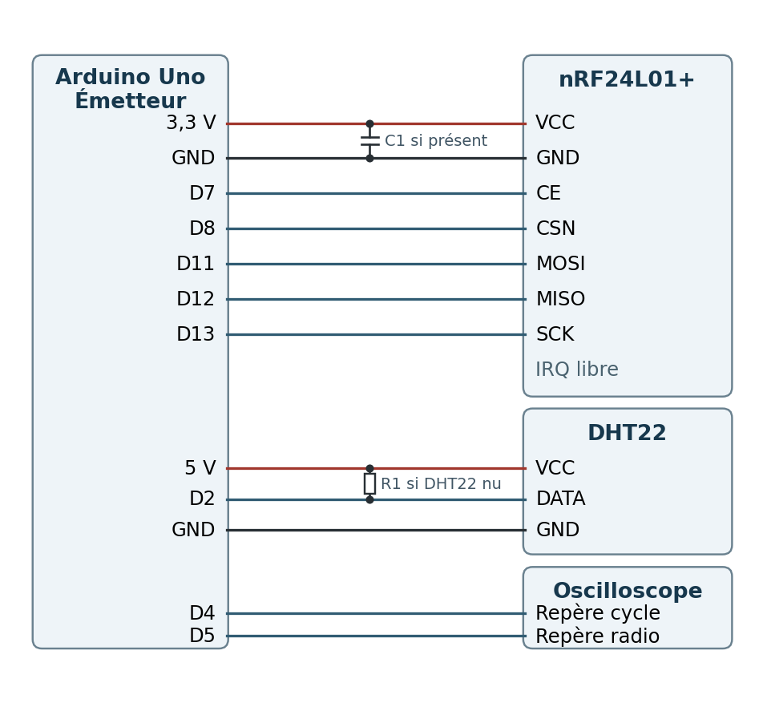
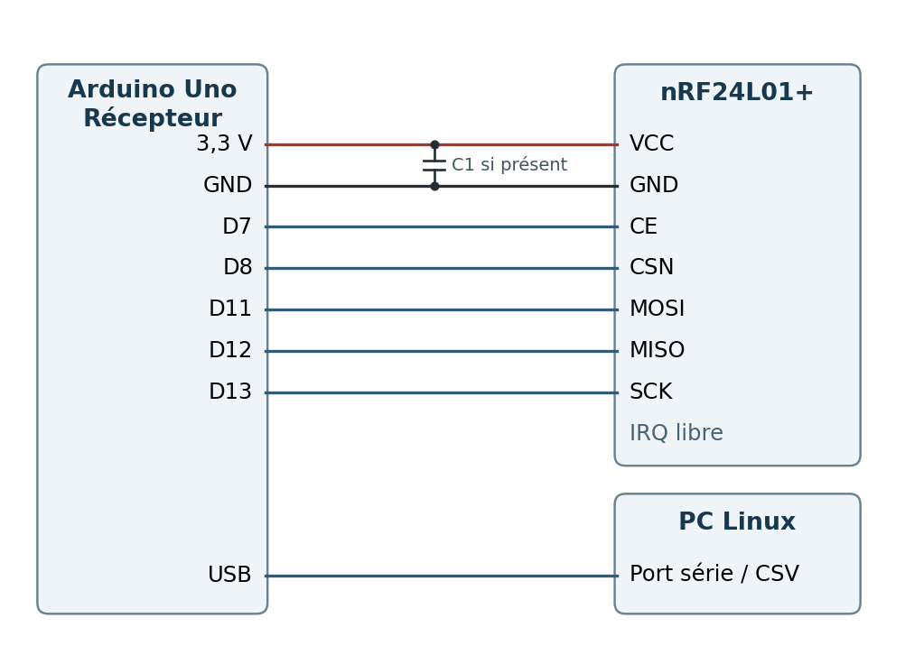
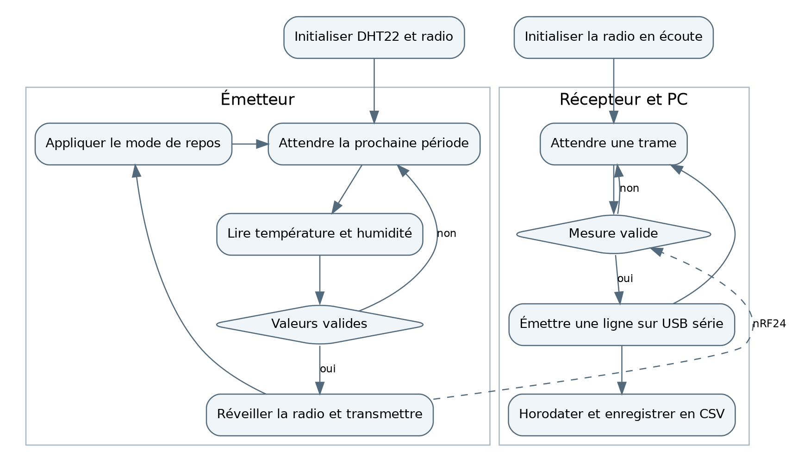

# Plateforme sans fil de mesure de température et d’humidité

**ESIEE Paris · Capteurs et acquisition de données**  
Groupe et date de séance à compléter.

## Plan

1. Introduction et fonctionnement
2. Schémas de câblage et organigramme
3. Mesures des grandeurs physiques
4. Protocole de mesure énergétique
5. Résultats et conclusion

## Introduction et fonctionnement

La plateforme acquiert la température et l’humidité avec un DHT22. Un Arduino Uno émet ces deux valeurs toutes les deux secondes par radio à 2,4 GHz. Un deuxième Uno reçoit les trames et les transmet à un PC par USB série. Le PC affiche les valeurs au terminal et les stocke dans un CSV avec le temps écoulé depuis le début de la capture. Le périmètre retenu pour cette version couvre la température et l’humidité, avec le DHT22 seul, et l’affichage sur le PC.

Chaque trame de mesure transporte un identifiant de format, un numéro de cycle, la température en centièmes de degré Celsius et l’humidité relative en centièmes de point de pourcentage. Le nRF24 envoie une charge utile fixe de 32 octets. Le récepteur valide les valeurs avant de les transmettre au PC. Le format des données conserve les décimales sans présumer de la précision du capteur.

## Schémas de câblage et organigramme

Les diagrammes reprennent les broches utilisées par le firmware. Vérifier le brochage physique et compléter les schémas avec les composants effectivement montés. Utiliser l’alimentation **3,3 V** pour le nRF24. Sur un DHT22 nu, ajouter une résistance de rappel entre DATA et son alimentation si elle est absente du module. Le circuit de découplage du nRF24, s’il est monté, est raccordé entre son VCC et sa masse, au plus près du module. La sortie LED du récepteur sur D2 sert aux commandes du TP d’origine. Si elle est câblée, reporter sa résistance série et son raccordement sur le schéma final.

**Annexe logicielle.** Les programmes Arduino complets sont fournis dans `Emmeteur/src/main.cpp` et `Recepteur/src/main.cpp`. Chaque projet contient ses propres réglages et sa définition de la trame. Les projets incluent la bibliothèque RF24 fournie dans le TP.

## Mesures des grandeurs physiques

1. Alimenter les deux cartes, lancer la capture série du récepteur et laisser les valeurs se stabiliser.
2. Enregistrer quelques minutes en situation stable. Noter les conditions, le début de l’essai et tout changement imposé au capteur.
3. Générer les courbes de température et d’humidité à partir du CSV. Insérer les deux séries et relever la plage et l’évolution observées.
4. Vérifier les éventuels sauts de numéro de cycle. Un saut peut correspondre à une lecture DHT22 invalide ou à une trame absente de la capture. Pour les distinguer, consulter le journal de l’émetteur lors d’un essai de diagnostic séparé.

**Courbes et observations à insérer à partir du CSV de séance.**

## Protocole de mesure énergétique

Commencer par le mode `Listening`, qui reproduit l’écoute radio au repos du code initial avec le format de trame de cette version. Refaire l’essai en `Standby` puis en `PowerDown`, avec la même période de 2 s, le même canal et le même débit. Le mode `Standby` garde le nRF24 alimenté en veille radio. Le mode `PowerDown` remet le nRF24 en économie d’énergie après chaque envoi. L’Arduino et le DHT22 restent alimentés. Le récepteur reste en écoute et renvoie l’acquittement.

Mesurer séparément la branche d’alimentation du nRF24 émetteur, celle du DHT22 et l’alimentation de l’émetteur complet. Pour chaque périmètre, relever la tension d’alimentation et enregistrer le courant avec l’instrument du banc. Avec une résistance shunt, relever la tension à ses bornes avec une mesure différentielle adaptée et utiliser `I = U_shunt / R_shunt`. Choisir le calibre ou le shunt avec l’encadrant pour limiter la chute de tension et couvrir à la fois la veille et les pics d’émission.

| Repère sur l’émetteur | Front montant | Front descendant |
|---|---|---|
| D4 | Début de l’acquisition DHT22 | Fin de l’acquisition et de l’envoi associé |
| D5 | Début de la séquence radio, réveil inclus | Retour au mode de repos radio |

Prendre le GND de l’Uno comme référence des sondes qui lisent D4 et D5. Utiliser D5 pour délimiter la phase active du **nRF24**. Utiliser D4 pour l’**émetteur complet** et pour délimiter la fenêtre d’acquisition lors de la mesure du **DHT22**. Cette dernière fenêtre englobe aussi l’envoi radio. Pour mesurer spécifiquement l’activité du capteur, isoler sa branche et délimiter sa phase active sur la trace de courant ou sur sa ligne DATA. Capturer plusieurs cycles. Pour le repos, relever la durée entre le front descendant et le front montant suivant du repère choisi. Rapporter la durée moyenne de chaque phase, le courant moyen et le pic observé si la résolution de l’instrument le permet.

En mode `PowerDown`, le repère radio inclut le délai de stabilisation de 5 ms présent dans la bibliothèque RF24 du projet. Les mesures du module en montage peuvent inclure des charges propres au matériel utilisé. Comparer les résultats à la fiche Nordic uniquement à conditions de tension, de débit, de puissance et d’état radio comparables.

## Résultats et conclusion

Reporter les résultats par périmètre et par scénario dans `mesures_energie.csv`. Conserver la distance et la géométrie du montage et modifier une variable à la fois.

| Variable | Valeurs d’essai |
|---|---|
| Repos radio | Écoute, Standby, PowerDown |
| Débit | 250 kbit/s si les deux modules le permettent, 1 Mbit/s, 2 Mbit/s |
| Canal | 10, 30, 70, soit 2,410, 2,430 et 2,470 GHz |
| Puissance de l’émetteur | −18, −12, −6 et 0 dBm |
| Période de mesure | 2 s, 5 s et 10 s |

À tension d’alimentation approximativement constante, calculer la puissance de phase avec `P = U × I_moyen` et l’énergie d’un cycle avec `E = P_repos × t_repos + P_actif × t_actif`. La puissance moyenne est `E / (t_repos + t_actif)`. Le rapport cyclique est la durée active divisée par la durée totale du cycle. Si la tension varie sensiblement, intégrer la puissance instantanée mesurée sur le cycle.

Pour chiffrer le gain, diviser la différence de puissance moyenne entre référence et essai par la puissance moyenne de référence, puis multiplier par 100. Conserver le même périmètre pour chaque comparaison. Lorsque la période change, présenter aussi l’énergie par cycle et le nombre de mesures reçues par minute. Pour un essai de portée ou de puissance d’émission, relever également le nombre de trames reçues sur le nombre de tentatives de transmission.

**Conclusion à compléter après les essais.** Indiquer le meilleur réglage mesuré pour le montage, son gain et son effet sur la disponibilité des mesures.

## Sources

- Sujet ESIEE Paris, *Réalisation d’une plateforme multi-capteurs sans fil fonctionnant à 2.4 GHz – Mesure de la consommation en énergie*, pages 2 et 3.
- Nordic Semiconductor, [nRF24L01+ Product Specification v1.0](https://docs-be.nordicsemi.com/bundle/nRF24L01P_PS_v1.0/raw/resource/enus/nRF24L01P_PS_v1.0.pdf).
- Adafruit, [DHT sensor library](https://github.com/adafruit/DHT-sensor-library).
- Bibliothèque RF24 et projets de départ fournis dans `TP.zip`.
